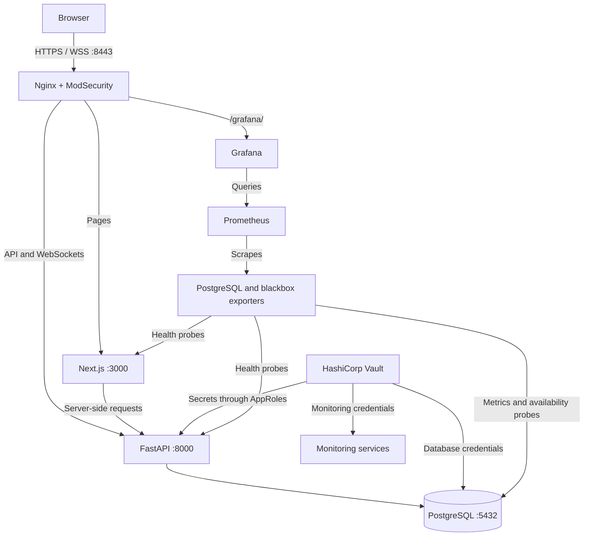
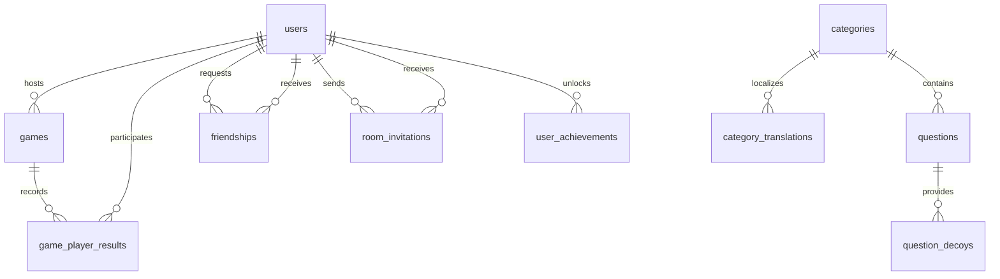

*This project has been created as part of the 42 curriculum by obouizi, eelkabia, sjoukni, hakader, abougati.*

# Trivia Trap — ft_transcendence

A real-time multiplayer trivia and bluffing game built with Next.js, FastAPI, and PostgreSQL.

## Table of Contents

- [Description](#description)
- [Project Layout](#project-layout)
- [Team Information](#team-information)
- [Project Management](#project-management)
- [Technical Stack](#technical-stack)
- [Database Schema](#database-schema)
- [Instructions](#instructions)
- [Features List](#features-list)
- [Modules](#modules)
- [Individual Contributions](#individual-contributions)
- [Resources](#resources)
- [Known Limitations](#known-limitations)

## Description

Trivia Trap is a multiplayer trivia and bluffing game built for **ft_transcendence**. Players join a shared room, invent convincing wrong answers, and try to identify the real answer while tricking their opponents. The goal is to combine a complete browser game with real-time communication, user accounts, social features, and containerized infrastructure.

Games progress through a lobby, category selection, answer submission, voting, reveal, and podium. The project includes English and Arabic questions, configurable rounds and timers, room chat, friend invitations, profiles, match history, and persistent achievements.

### Key Features

- **Synchronized multiplayer:** Shared lobbies, timed rounds, bluff submissions, voting, and score reveals over WebSockets.
- **Server-managed game state:** Backend validation, phase transitions, timers, and scoring coordinate connected clients.
- **Bilingual trivia:** Locally seeded English and Arabic questions with fallback decoy answers.
- **Social play:** Room chat, friendships, online presence, and live room invitations.
- **Player progression:** Profiles, match history, statistics, match standings, and persistent achievements.
- **Infrastructure:** HTTPS, ModSecurity, Vault, automated backups, and Prometheus/Grafana monitoring.

### Architecture



Only the gateway publishes host ports. HTTP on port 8080 redirects to HTTPS on 8443. Vault supplies stored secrets through restricted service identities; Prometheus collects exporter metrics and availability probes.

## Project Layout

```text
frontend/
  src/
    app/                    # Next.js pages, layouts, and server components
    components/             # Shared UI, profiles, social features, and game views
    hooks/                  # React hooks
    lib/                    # API clients and frontend helpers
    stores/                 # Client game state
    types/                  # TypeScript data and event types
  public/                   # Static assets
backend/
  app/
    engine/                 # WebSocket rooms, game phases, and event handling
    authentication/         # Password login, Google sign-in, JWTs, and reset flow
    users/                  # Profiles, uploads, presence, and history endpoints
    friendship/             # Friend requests and friend management
    invitations/            # Room invitations and notification sockets
    dataProcessing/         # ORM models, queries, scoring, achievements, and seeding
    data/questions/         # English and Arabic trivia datasets
    main.py                 # FastAPI application
  alembic/                  # Versioned database migrations
  scripts/                 # Backend startup
infra/
  nginx/                    # HTTPS gateway and WAF configuration
  vault/                    # Vault bootstrap, policies, and agents
  postgres/                 # Database container
  backup/                   # Backup and restore scripts
  monitoring/               # Prometheus, Grafana, exporters, and secret loading
  tests/                    # Infrastructure smoke tests
docs/                       # Schema audit and supporting documentation
compose.yaml                # Service orchestration
Makefile                    # Start, stop, and rebuild shortcuts
.env.example                # Environment configuration template
```

## Team Information

All five members contribute as developers. Leadership roles follow the team's confirmed assignments; feature responsibilities are described below and in [Notes.md](Notes.md).

| Member | Documented role / focus | Responsibilities |
| --- | --- | --- |
| **obouizi** | Technical Lead / Architect and Developer | Technical architecture and direction; client updates, connection/disconnection handling, broadcasts, chat, profile editing, avatars, and game statistics. |
| **sjoukni** | Project Manager and Developer | Project coordination and progress tracking; ORM integration, leaderboard integration, and achievement/gamification logic. |
| **hakader** | Developer — authentication and friendships | Authentication, friend management, and friends' online status. |
| **abougati** | Product Owner and Developer | Product priorities and requirements; WAF/ModSecurity, Vault secrets, Prometheus, and Grafana. |
| **eelkabia** | Developer — frontend and profiles | Server rendering, reusable components, profile pages, match history, and achievement/progression displays. |

## Project Management

The team used **GitHub Issues** to distribute tasks, track progress, and collaborate on code. Modules were assigned to individual members, with regular meetings to discuss progress, challenges, and next steps. A **Discord server** was the main channel for quick updates and discussions.

## Technical Stack

| Layer | Technologies | Purpose and rationale |
| --- | --- | --- |
| Frontend | Next.js 16.3.5, React 19.2.8, TypeScript | Server-rendered pages and interactive game components within one application, with typed API and event models. |
| Styling and UI | Tailwind CSS 4, reusable UI components, Radix/Base UI, Lucide icons | Shared visual styling and reusable controls for consistent screens. |
| Backend | FastAPI, Pydantic, Python 3.13 | Typed request validation, HTTP routes, generated API documentation, and asynchronous WebSockets. |
| Game state | python-statemachine, asyncio | Explicit game phases, timers, synchronized transitions, and reconnect snapshots. |
| Database | PostgreSQL 16 | Relational storage with foreign keys, uniqueness rules, transactions, and indexes for accounts and match results. |
| Persistence | SQLAlchemy async ORM,  Alembic | Typed models, asynchronous database access, and versioned schema migrations. |
| Authentication | Argon2 via pwdlib, PyJWT, google-auth | Password hashing, JWT sessions in HttpOnly cookies, and verified Google identities. |
| Gateway and secrets | Nginx, ModSecurity with OWASP CRS, HashiCorp Vault | HTTPS routing, request filtering, rate limiting, and generated secrets delivered through restricted AppRoles. |
| Operations | Docker Compose, Prometheus, Grafana, PostgreSQL and blackbox exporters | Reproducible service orchestration, database metrics, availability probes, and dashboards. |

Browsers access the frontend, API, and WebSockets through Nginx. Browser API calls use `/api/`; server-rendered frontend pages use `http://backend:8000` on the Docker network. Room sockets use `/ws/room/{code}` externally. PostgreSQL, Vault, and Prometheus have no directly published host ports.

## Database Schema

The schema is defined in [the SQLAlchemy models](backend/app/dataProcessing/models.py) and versioned by [Alembic migrations](backend/alembic/versions). A visual diagram is available in [db_schema.pdf](db_schema.pdf). The following table describes the current ten application tables; `PK` means primary key and `FK` means foreign key.

### Entity Relationships



### Tables and Key Fields

| Table | Key fields and data types | Relationships / purpose |
| --- | --- | --- |
| `users` | `id INTEGER PK`; `username VARCHAR(50)`; `email VARCHAR(255)`; normalized keys `TEXT`; `password_hash`, `google_sub VARCHAR(255)`; avatar/cover `TEXT`; `auth_version INTEGER`; reset digest `VARCHAR(64)`; reset and creation timestamps `TIMESTAMPTZ` | Central account identity. Unique usernames, emails, normalized identity keys, and Google subjects; at least one authentication method is required. |
| `categories` | `id INTEGER PK`; `image_url TEXT` | Parent of category translations and questions. |
| `category_translations` | Composite PK: `category_id INTEGER FK`, `language_code VARCHAR(5)`; `name VARCHAR(100)` | Localized category names; references `categories`. |
| `questions` | `id INTEGER PK`; `category_id INTEGER FK`; `language_code VARCHAR(5)`; `question_text VARCHAR(500)`; `correct_answer VARCHAR(200)`; `image_url TEXT` | Belongs to a category; indexed by category and language. |
| `question_decoys` | `id INTEGER PK`; `question_id INTEGER FK`; `decoy_text VARCHAR(200)` | Fallback wrong answers; unique per question and text. |
| `games` | `id UUID PK`; `host_user_id INTEGER FK`; `total_rounds INTEGER`; `started_at`, `finished_at TIMESTAMPTZ` | Saved matches, each hosted by a user. |
| `game_player_results` | Composite PK: `game_id UUID FK`, `user_id INTEGER FK`; `final_score`, `final_rank INTEGER` | Joins users to games; stores each player's final result. |
| `friendships` | Composite PK: `requester_id INTEGER FK`, `receiver_id INTEGER FK`; `status VARCHAR(20)`; `created_at TIMESTAMPTZ` | Links two users; prevents self-friendships and duplicate unordered pairs. |
| `room_invitations` | `id UUID PK`; sender/recipient `INTEGER FK`; `room_code VARCHAR(6)`; `status VARCHAR(20)`; creation/expiry `TIMESTAMPTZ` | Links users to invitations for live rooms; prevents duplicate pending invitations. |
| `user_achievements` | Composite PK: `user_id INTEGER FK`, `achievement_code VARCHAR(50)`; `unlocked BOOLEAN` | Persistent unlocks; descriptions and images come from achievement definitions in code. |

A category has many translations and questions; a question has many decoys. A user hosts many games and participates in many games through `game_player_results`. Friendships and invitations each reference users twice, for the two participants. Achievements belong to users.

Active rooms, timers, submitted bluffs, votes, and chat are held in backend memory rather than dedicated database tables. Invitation room codes therefore do not reference a database room table. The removed `game_player_category_results` table is not part of the current schema; see the [schema audit](docs/database-schema-audit.md).

## Instructions

### Prerequisites

- Docker Engine with the Docker Compose   plugin (`docker compose`), running and accessible to your user.
- A browser with JavaScript and WebSocket support.
- Available host ports **8080** and **8443**, and internet access for the initial image and dependency downloads.
- For Google sign-in, a Google web client ID configured for the origin you use. For password-reset email, a Gmail account with an SMTP app password.

The Docker build supplies Python **3.13**, Node.js **22**, pnpm **12.4.2**, and PostgreSQL **16**. These do not need to be installed on the host for the Compose workflow. Backend dependencies are locked in `backend/uv.lock`; frontend dependencies are locked in `frontend/pnpm-lock.yaml`.

### Configure and start

1. Clone this repository and open its root directory.
2. Copy the environment template:

   ```sh
   cp .env.example .env
   ```

3. Edit `.env` for your environment:

   | Variable | Purpose |
   | --- | --- |
   | `POSTGRES_DB` | Database name; the template uses `trivia_db`. |
   | `POSTGRES_USER` | Database user; the template uses `admin`. |
   | `GOOGLE_CLIENT_ID` | Your Google web client ID; also passed to the frontend during its build. |
   |
   | `PASSWORD_RESET_URL` | Set to `https://localhost:8443/reset-password` for the default Docker deployment. |
   | `GRAFANA_ROOT_URL` | Optional; defaults to `https://localhost:8443/grafana/`. |

   The template's `POSTGRES_HOST` and `POSTGRES_PORT` are not used to expose PostgreSQL in Compose. Containers reach it on the internal Docker network. Vault generates the database password, JWT signing key, and Grafana administrator password; do not add a database password or JWT key to `.env` for this workflow. Keep `.env` private.

4. **Create the required SMTP secret file** before the first startup. From the repository root, create the secrets directory:

   ```sh
   mkdir -p secrets
   ```

   Using your editor, create `secrets/smtp_password` and save only the Gmail SMTP app password for the address in `SMTP_EMAIL`—without a variable name or surrounding quotes. The file must be non-empty; initial Vault setup fails if it is missing or empty.

   Compose mounts this file for Vault bootstrap. Vault stores the password and injects `SMTP_PASSWORD` into the backend at runtime, so do not put the password in `.env`. The secret file is ignored by Git; keep it private.

5. Build and start the application:

   ```sh
   make
   ```

6. Open **https://localhost:8443**. Nginx generates a self-signed local certificate on first startup, so the browser will ask you to trust it for local testing. HTTP on port 8080 redirects to HTTPS.

### Play

1. Register and sign in, or use Google sign-in after configuring its client ID.
2. Create a room and share its six-character code, or join an available room. Friends can also receive room invitations.
3. Join with at least two separate accounts. The default room capacity is ten players.
4. Configure the room, start the game, select a category, submit a bluff, and vote for the answer you believe is correct.
5. Review the reveal and podium, then visit your profile, history, and achievements after the match.


### Useful addresses and commands

| Address | Purpose |
| --- | --- |
| `https://localhost:8443` | Game and frontend |
| `https://localhost:8443/docs` | FastAPI Swagger documentation |
| `https://localhost:8443/openapi.json` | OpenAPI schema |
| `https://localhost:8443/api/health` | Backend liveness |
| `https://localhost:8443/api/ready` | Backend/database readiness |
| `https://localhost:8443/status` | Service status page |
| `https://localhost:8443/backup-status` | Backup status JSON |
| `https://localhost:8443/grafana/` | Grafana dashboards |

Grafana uses the username `admin`. On your own deployment, retrieve its generated password with:

```sh
docker compose exec grafana cat /run/monitoring-secrets/grafana_admin_password
```

Stop the application while retaining its named volumes:

```sh
docker compose down --remove-orphans
```

`make down-v` also deletes volumes, including database contents, uploads, backups, and Vault state. Use it only for an intentional full reset.

For frontend development checks, with Node.js 22 and the pinned pnpm installe


Infrastructure smoke-test scripts are available in `infra/tests/`; inspect each script's prerequisites before running it against a deployment.

### Make Targets

| Command | Effect |
| --- | --- |
| `make` / `make up` | Build images and start the stack in the background. |
| `make down` | Stop and remove containers and orphaned services, retaining volumes. |
| `make re` | Stop the stack, rebuild images, and start it again. |
| `make down-v` | Stop the stack and delete its named volumes, including persisted data. |
| `docker compose logs -f` | Follow service logs. |
| `docker compose ps -a` | Inspect service state, including one-shot containers. |

## Features List

Ownership follows the documented task split; shared features span multiple members.

| Feature | Functionality | Contributors |
| --- | --- | --- |
| Trivia and bluffing game | Category selection, bluffs, voting, reveal, scoring, and podium through explicit game phases. | obouizi: engine work evidenced by history; sjoukni: scoring/progression; eelkabia: game UI. |
| Rooms and multiplayer | Create/join rooms by code, configure rounds/timers/language, and play with multiple accounts. | obouizi, eelkabia; hakader contributed room language support. |
| Real-time synchronization | WebSocket broadcasts, presence, disconnect handling, and restoration of the current phase on reconnect. | obouizi; eelkabia contributed presence integration. |
| Room chat | Send and receive messages during a shared game session. | obouizi |
| Accounts | Registration, password login, logout, Google sign-in, username selection, and email password reset. | hakader |
| Friends and invitations | Search/manage friends, handle requests, view online status, and receive room invitation notifications. | hakader; eelkabia contributed frontend/presence integration. |
| Profiles and settings | View profiles, edit account information, upload avatars, and display a fallback avatar. | obouizi, eelkabia |
| Statistics and history | Persist results and display scores, ranks, opponents, dates, and profile statistics. | obouizi, sjoukni, eelkabia |
| Achievements and leaderboard | Evaluate unlock conditions, persist achievements, and display progression and match standings. | sjoukni, eelkabia |
| Shared UI and SSR | Server-rendered account pages, reusable controls, loading/error states, and common styling. | eelkabia |
| Gateway and secrets | HTTPS, WAF filtering, API rate limits, and Vault-backed database/JWT/Grafana credentials. | abougati |
| Monitoring | Prometheus probes and metrics, provisioned Grafana dashboards, and alert rules. | abougati |
| Backups and status | Scheduled PostgreSQL backups, retention, backup health JSON, status page, and restore tooling. | Infrastructure implementation; individual ownership not specified in Notes.md. |

## Modules


| Type | Selected module | Points | Rationale and implementation | Contributors |
| --- | --- | ---: | --- | --- |
| Major | Frontend and backend frameworks | 2 | Next.js/React and FastAPI provide structured UI, routing, validation, and service code. | Frontend: eelkabia; backend: obouizi, sjoukni, hakader. |
| Major | Real-time features | 2 | WebSockets synchronize room phases, player events, chat, and notifications. | obouizi; social integration: hakader, eelkabia. |
| Major | User interaction | 2 | Profiles, friendships, and room chat make the game social. | obouizi, hakader, eelkabia. |
| Major | Public API with secured API key | 2 | Selected to support external database access. HTTP endpoints, OpenAPI documentation, and Nginx limits.| sjoukni, hakader; gateway: abougati. |
| Minor | ORM | 1 | SQLAlchemy models and relationships centralize persistence; Alembic tracks schema changes. | sjoukni |
| Minor | Server-side rendering | 1 | Async Next.js pages fetch profile/account data on the server. | eelkabia |
| Minor | Custom design system | 1 | Shared colors/typography/icons and over ten UI components: button, input, card, badge, avatar, dialog, dropdown, tooltip, pagination, skeleton, and loading/error/empty states. | eelkabia |
| Major | Standard user management | 2 | Accounts, hashed passwords, sessions, editable profiles, avatars, and friendships. | hakader, obouizi, eelkabia. |
| Minor | Statistics and match history | 1 | Stored game/player results power profile summaries and history pages. | obouizi, sjoukni, eelkabia. |
| Minor | Remote authentication with OAuth 2.0 | 1 | Google sign-in verifies identity tokens and links accounts by Google subject. | hakader |
| Major | WAF/ModSecurity and Vault | 2 | OWASP CRS blocking at paranoia level 2 plus Vault KV/AppRole secret delivery protect the gateway and credentials. | abougati |
| Major | Complete web game | 2 | A playable trivia/bluffing loop connects rooms, rounds, scoring, and results. | obouizi, sjoukni; frontend: eelkabia. |
| Major | Remote players | 2 | Separate clients share authoritative backend state through WebSockets; a reachable host/origin configuration is required. | obouizi, eelkabia; deployment: abougati. |
| Major | Multiplayer beyond two players | 2 | Rooms support multiple players, with a default capacity of ten. | obouizi, eelkabia. |
| Minor | Gamification | 1 | Achievement conditions and persistent unlocks reward player actions. | sjoukni; display: eelkabia. |
| Major | Prometheus and Grafana monitoring | 2 | Exporters, availability probes, dashboards, and alert rules expose infrastructure health. | abougati |

**Selected total: 10 Major × 2 + 6 Minor × 1 = 26 points.** 
###
### Implementation References

| Area | Source |
| --- | --- |
| Room lifecycle and sockets | [room_manager.py](backend/app/engine/room_manager.py) |
| Game events and phase transitions | [events.py](backend/app/engine/events.py), [room_models.py](backend/app/engine/room_models.py) |
| Accounts and socket authentication | [authentication](backend/app/authentication), [current_user.py](backend/app/authentication/current_user.py) |
| Friends and invitations | [friendship](backend/app/friendship), [invitations](backend/app/invitations) |
| ORM and migrations | [models.py](backend/app/dataProcessing/models.py), [alembic](backend/alembic) |
| Server-rendered profiles | [profile page](frontend/src/app/profile/page.tsx), [public user page](frontend/src/app/users/[username]/page.tsx) |
| Reusable design components | [UI components](frontend/src/components/ui) |
| WAF and secrets | [nginx](infra/nginx), [vault](infra/vault) |
| Metrics and dashboards | [Prometheus configuration](infra/monitoring/prometheus/prometheus.yml), [Grafana dashboards](infra/monitoring/grafana/dashboards) |

## Individual Contributions

### obouizi — Technical Lead / Architect and Developer

Developed real-time event delivery, the room connection lifecycle, room chat, profile editing, avatar uploads, and player statistics. Engine history also records game completion and voting feedback work.

**Technical challenge:** Keeping returning clients aligned with the current game phase. The engine retains the phase payload and deadline and sends them to reconnecting players. Asynchronous timer tasks and a phase lock coordinate transitions.

### eelkabia — Developer

Developed server-rendered frontend pages, reusable UI components, profiles, match history, achievement displays, and game views. History also records room UI and presence integration.

**Technical challenge:** Coordinating authenticated server rendering with interactive views. Server pages fetch user data, redirect on authentication failures, and supply data to client components; loading and error states handle unavailable data.

### sjoukni — Project Manager and Developer

Coordinated project progress and contributed ORM/database integration, leaderboard and progression logic, and persistent achievements. Schema cleanup in the commit history removes unused result fields and category-result storage. The supplied draft also assigns public API work to sjoukni alongside hakader; API-key protection remains incomplete.

**Technical challenge:** Keeping stored data aligned with actual application queries. Alembic migrations remove unused structures, while achievement definitions remain in code and unlock state is persisted in PostgreSQL.

### hakader — Developer

Developed authentication and friendship flows, including account access and friend status requirements. History also records room-language support. The supplied draft assigns public API work jointly with sjoukni.

**Technical challenge:** Authenticating browser WebSockets. The current backend reads the HttpOnly session cookie at connection time, verifies the JWT and account authentication version, and binds the account to the socket. Password authentication uses Argon2.

### abougati — Product Owner and Developer

Owns product priorities and requirements and developed infrastructure for WAF/ModSecurity, Vault, and monitoring. Prometheus and Grafana combine database metrics with availability probes.

**Technical challenge:** Running the gateway and dependent services under local container constraints. The gateway uses ports 8080/8443 for rootless Docker, while restricted Vault AppRoles and service startup dependencies provide credentials before applications start.

These challenge descriptions summarize solutions visible in the code. They do not assert an independently verified history of debugging incidents.

## Resources

- [FastAPI documentation](https://fastapi.tiangolo.com/) — HTTP APIs, validation, and WebSockets.
- [Next.js documentation](https://nextjs.org/docs) — App Router, server rendering, and frontend architecture.
- [SQLAlchemy documentation](https://docs.sqlalchemy.org/) and [Alembic documentation](https://alembic.sqlalchemy.org/) — ORM relationships and migrations.
- [PostgreSQL documentation](https://www.postgresql.org/docs/16/) — relational storage and constraints.
- [HashiCorp Vault documentation](https://www.vaultproject.io/docs) — secret storage and service authentication.
- [OWASP Core Rule Set](https://coreruleset.org/docs/) — ModSecurity request filtering.
- [Prometheus documentation](https://prometheus.io/docs) and [Grafana documentation](https://grafana.com/docs) — metrics and dashboards.
- [Google OAuth 2.0 documentation](https://developers.google.com/identity/protocols/oauth2) — Google authentication.
- Local references: [project subject](en.subject.pdf), [team notes](Notes.md), [schema diagram](db_schema.pdf), [schema audit](docs/database-schema-audit.md), [achievement notes](docs/data_docs/achievement.md), and [password-reset documentation](backend/app/authentication/docs/password-reset.md).

### Use of AI

AI assisted with generating the initial trivia questions, explaining concepts, producing code snippets, and suggesting implementation practices. Assistance focused on real-time features, authentication mechanisms, and monitoring integrations. The team reports reviewing and testing final implementations against the project requirements.

AI also assisted in drafting this README by comparing the subject's README requirements, team notes, database diagram, and repository source. The documentation review did not run the complete application or independently verify the team's testing claims.


